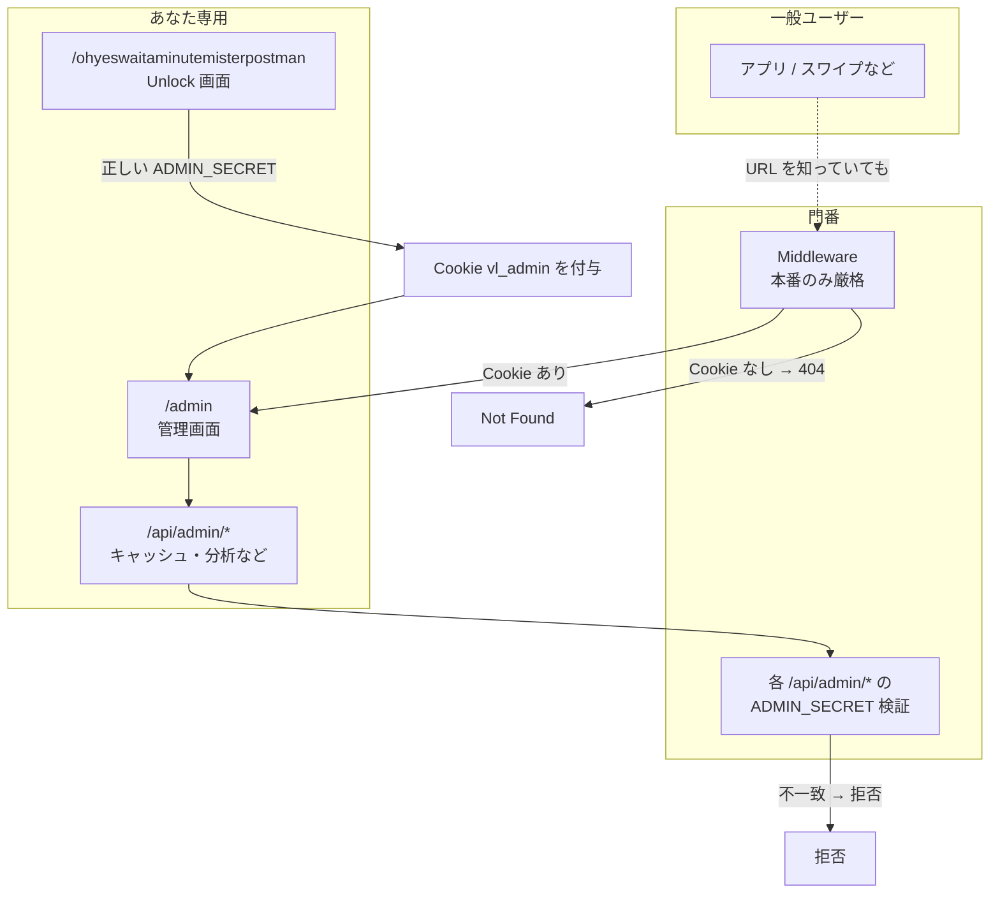
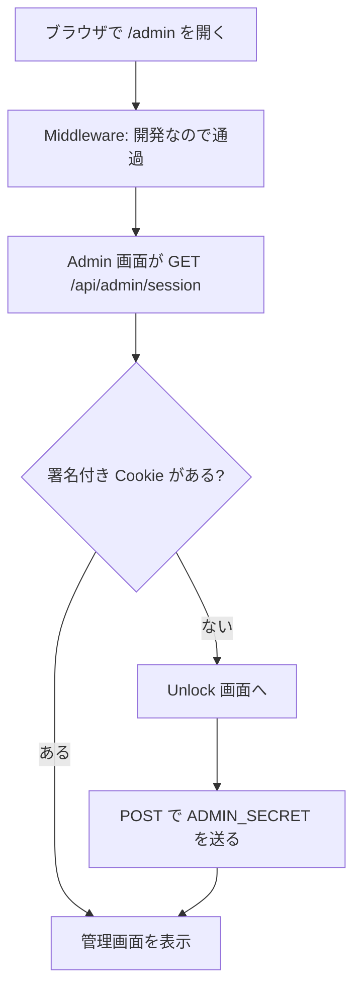
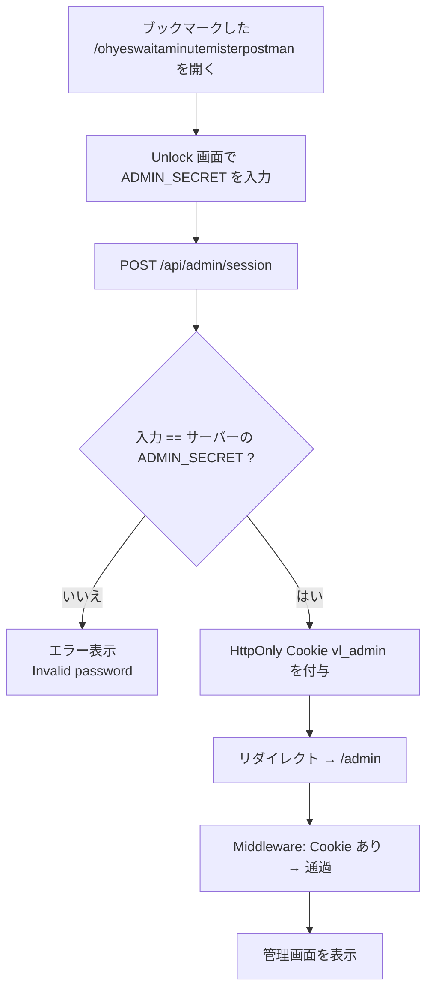
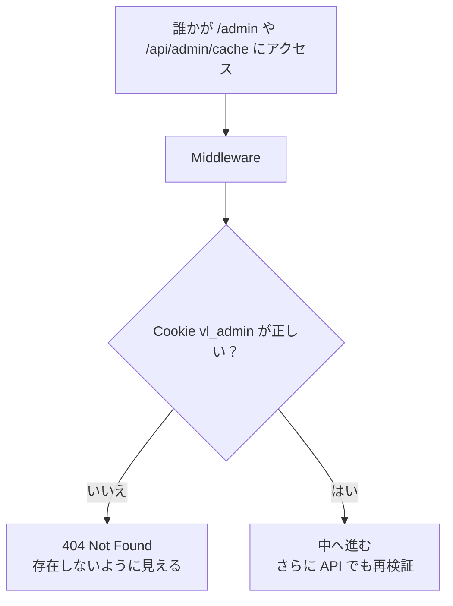
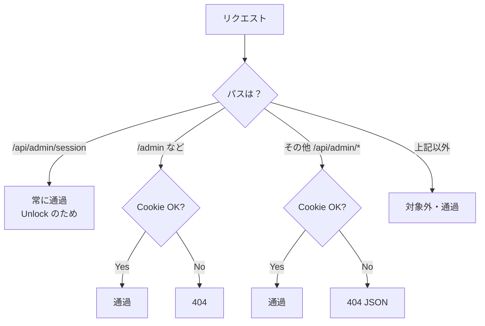
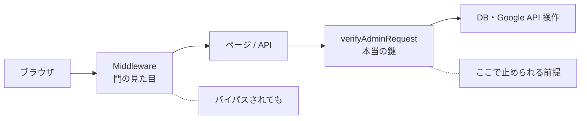

# Admin アクセスの仕組み（フローチャート）

一般ユーザー向けアプリとは別に、**あなた専用の管理画面**を守るための流れです。

## 登場人物（用語）

| 名前 | 意味 |
|------|------|
| `ADMIN_SECRET` | `.env.local` / Vercel に置く秘密の文字列。サーバーだけが知る |
| Cookie `vl_admin` | Unlock 成功後にブラウザへ付く HttpOnly Cookie（JS からは読めない） |
| `/admin` | 管理画面本体 |
| `/ohyeswaitaminutemisterpostman` | 本番用の Unlock 入口（公開ナビには出さない。ブックマーク用） |
| `/api/admin/session` | ログイン状態の確認・Unlock・ログアウト用 API |
| Middleware | 本番で「Cookie なしなら `/admin` を 404」にする門番 |
| API の `verifyAdminRequest` | 各 admin API の本当の鍵チェック（Middleware より重要） |

---

## 全体像（なにを守っているか）

**ポイント:** Middleware は「画面を隠す」役。データ操作の本当の守りは **API 側の秘密検証**です。

---

## ローカル開発（development）

Middleware は素通りします。管理クッキーは、Unlock 画面で `ADMIN_SECRET` を入れたときだけ付きます。開いただけでは付きません。

秘密を空にして `ALLOW_INSECURE_ADMIN=1` にした開発だけ、パスワードなしで開きます。

**あなたがやること:** `npm run dev` → `http://localhost:3000/admin` → 表示された Unlock で `.env.local` の `ADMIN_SECRET` を入れる。

---

## 本番（production）— 初回 / Cookie 切れ

`/admin` を直接開いても **404** になります。Unlock 用 URL から入ります。

**あなたがやること:**

1. Vercel に `ADMIN_SECRET` を設定する  
2. `https://あなたのドメイン/ohyeswaitaminutemisterpostman` をブックマーク  
3. そこで秘密を入力 → `/admin` へ  

Cookie は約 **30 日**有効です。切れたら同じ Unlock URL から入り直します。

---

## 本番 — 一般ユーザーが `/admin` を開いた場合

Unlock 画面は公開ナビに出ていません。URL を知らなければたどり着きにくいです（加えて秘密が必要）。

---

## Middleware が通す / 弾くもの（本番）

開発時はこの図の前に「全部通過」があります。

---

## 二重の守り（なぜ Middleware だけでは足りないか）

| 層 | 役割 |
|----|------|
| Middleware | 本番で未ログインを 404 にして存在感を消す |
| `/api/admin/*` の検証 | 実際の操作を拒否する本丸 |
| Unlock URL の秘匿 | 入口をナビに出さない |
| `ADMIN_SECRET` | 知っている人だけが Cookie を得られる |

---

## よくある疑問

**Q. `/admin` が 404 なのにどうやって入る？**  
A. 本番は Unlock URL（`/ohyeswaitaminutemisterpostman`）だけが入口です。

**Q. ローカルで Unlock URL は必要？**  
A. `/admin` を開くと Unlock へ移ります。そこで `ADMIN_SECRET` を入れます。開いただけでは入れません。

**Q. Save や Access の秘密入力は？**  
A. 廃止済み。秘密は env のみ。本番の入力は Unlock 画面だけです。

**Q. 「アルゴリズム設定を本番に反映」は何？**  
A. 認証とは無関係。フィード設定を本番 `/api/swipe` に保存するボタンです。

---

## 関連ファイル

| ファイル | 役割 |
|----------|------|
| `src/middleware.ts` | 本番の門番 |
| `src/lib/admin/auth.ts` | Cookie / 秘密の検証 |
| `src/lib/admin/constants.ts` | Cookie 名・Unlock パス |
| `src/app/api/admin/session/route.ts` | ログイン API |
| `src/app/ohyeswaitaminutemisterpostman/page.tsx` | Unlock 画面 |
| `src/app/admin/page.tsx` | 管理画面 |
| `.env.local` の `ADMIN_SECRET` | ローカル用の秘密 |
