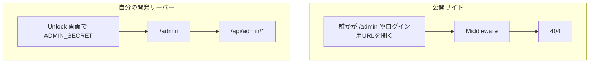
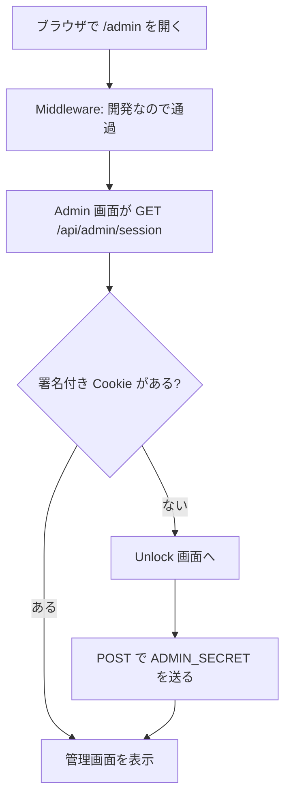
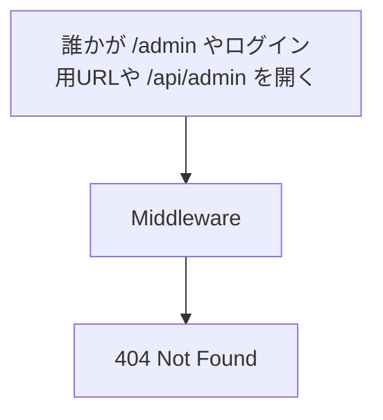
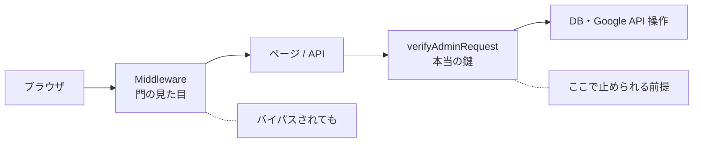

# Admin アクセスの仕組み（フローチャート）

一般ユーザー向けアプリとは別に、**あなた専用の管理画面**を守るための流れです。

## 登場人物（用語）

| 名前 | 意味 |
|------|------|
| `ADMIN_SECRET` | `.env.local` に置く秘密の文字列。開発サーバーだけが使う |
| Cookie `vl_admin` | Unlock 成功後にブラウザへ付く HttpOnly Cookie（JS からは読めない） |
| `/admin` | 管理画面本体 |
| `/ohyeswaitaminutemisterpostman` | 自分の開発サーバーだけの Unlock 入口 |
| `/api/admin/session` | ログイン状態の確認・Unlock・ログアウト用 API |
| Middleware | 公開サイトでは管理画面もログイン画面も 404 にする門番 |
| API の `verifyAdminRequest` | 各 admin API の本当の鍵チェック（Middleware より重要） |

---

## 全体像（なにを守っているか）

**ポイント:** 公開サイトに管理画面はありません。見るときは自分のパソコンの開発サーバーだけです。

---

## ローカル開発（development）

Middleware は素通りします。管理クッキーは、Unlock 画面で `ADMIN_SECRET` を入れたときだけ付きます。開いただけでは付きません。

秘密を空にして `ALLOW_INSECURE_ADMIN=1` にした開発だけ、パスワードなしで開きます。

**あなたがやること:** `npm run dev` → `http://localhost:3000/admin` → 表示された Unlock で `.env.local` の `ADMIN_SECRET` を入れる。

---

## 公開サイト（production）

管理画面も、パスワード欄も、管理用 API も出しません。合言葉が合っていても 404 です。人数を見るときは、自分のパソコンで `npm run dev` を動かします。ローカルの `.env.local` が本番のデータベースを指していれば、その人数が出ます。

---

## 二重の守り（なぜ Middleware だけでは足りないか）

| 層 | 役割 |
|----|------|
| Middleware | 公開サイトでは管理の入口をすべて 404 にする |
| `/api/admin/*` の検証 | 公開サイトでは拒否し、開発サーバーでは秘密を確認する |
| `ADMIN_SECRET` | 開発サーバーで知っている人だけが Cookie を得られる |

---

## よくある疑問

**Q. 公開サイトの `/admin` にはどうやって入る？**  
A. 入れません。自分のパソコンで `npm run dev` したときだけ開けます。

**Q. ローカルで Unlock URL は必要？**  
A. `/admin` を開くと Unlock へ移ります。そこで `ADMIN_SECRET` を入れます。開いただけでは入れません。

**Q. Save や Access の秘密入力は？**  
A. 廃止済み。秘密は env のみ。入力は開発サーバーの Unlock 画面だけです。

**Q. 「アルゴリズム設定を本番に反映」は何？**  
A. 認証とは無関係。フィード設定を本番 `/api/swipe` に保存するボタンです。

---

## 関連ファイル

| ファイル | 役割 |
|----------|------|
| `src/middleware.ts` | 本番の門番 |
| `src/lib/admin/auth.ts` | Cookie / 秘密の検証 |
| `src/lib/admin/constants.ts` | Cookie 名・Unlock パス |
| `src/app/api/admin/session/route.ts` | ログイン API |
| `src/app/ohyeswaitaminutemisterpostman/page.tsx` | Unlock 画面 |
| `src/app/admin/page.tsx` | 管理画面 |
| `.env.local` の `ADMIN_SECRET` | ローカル用の秘密 |
